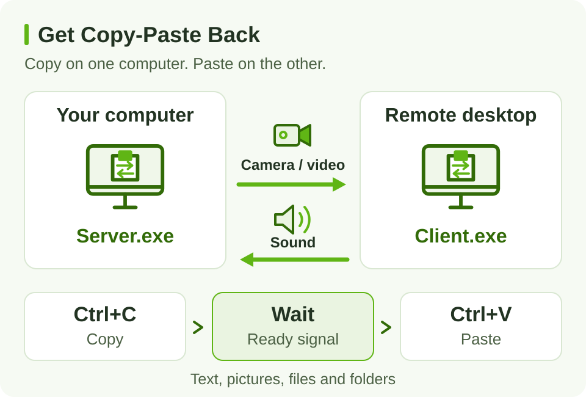
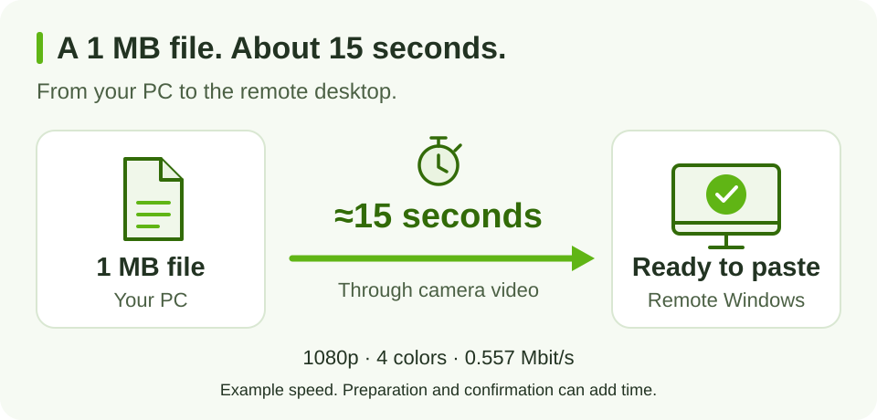
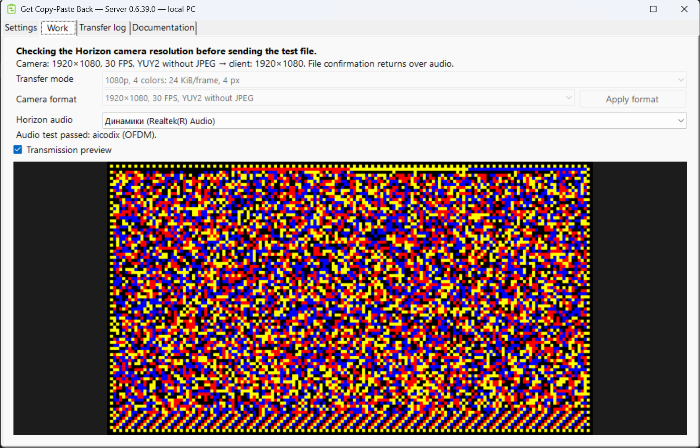
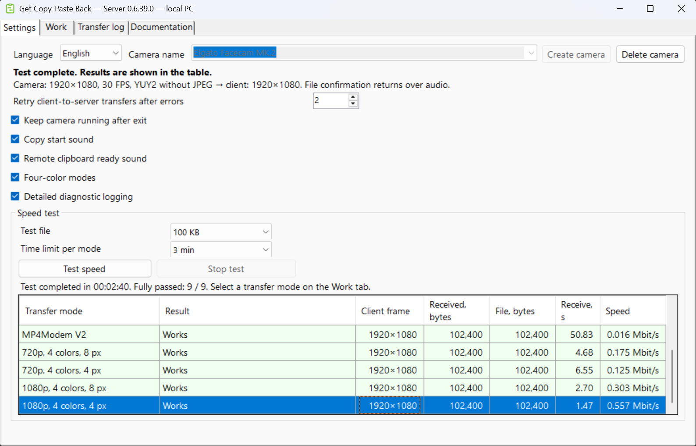

# Get Copy-Paste Back

[Русский](README.ru.md) · [Screenshots](screenshots/README.md) · [Technical guide](docs/TECHNICAL.md)

**Copy and paste not working in your remote Windows desktop? Copy text and files between your PC and the remote desktop again.**

Get Copy-Paste Back sends your clipboard through the camera and sound paths in your existing remote desktop connection. Copy with **Ctrl+C**, wait for the ready signal, then paste with **Ctrl+V** on the other side. Text, images, files and folders work in both directions.

**[Download the ready-to-use programs](https://github.com/AlexeySmirnov74/get-copy-paste-back/releases/latest)** — no compilation needed.

| Where to run it | Download |
| --- | --- |
| On your local PC or laptop | [Server.exe](https://github.com/AlexeySmirnov74/get-copy-paste-back/releases/latest/download/Server.exe) |
| Inside the remote Windows desktop | [Client.exe](https://github.com/AlexeySmirnov74/get-copy-paste-back/releases/latest/download/Client.exe) |

You need **64-bit Windows on both sides**, working camera and sound redirection, and administrator permission to create the camera on your local PC.

## How the two computers talk

The server creates a virtual camera; you do not need to point a real webcam at your screen.

## Platform compatibility

**Tested:** VMware Horizon / Omnissa Horizon.

**Not yet tested:** Citrix, Microsoft RDP, Azure Virtual Desktop, Windows 365 and Amazon WorkSpaces.

We expect the same approach to work if the platform exposes the redirected camera to Windows apps inside the remote desktop and sends remote sound back to your PC. Compatibility still needs testing on each platform. You may need to select the camera and audio output manually in **Client.exe**.

## First setup with Horizon

1. Download matching versions of both programs using the links above. Put each EXE in a writable folder on the correct computer.
2. On your local PC, open **Server.exe → Settings**, choose a camera name and click **Create camera**. Allow administrator access when Windows asks. If setup requests a restart, restart Windows and click **Create camera** again.
3. In Horizon, select this camera for redirection, then reconnect to the remote desktop.
4. Inside the remote desktop, run **Client.exe**. Right-click its green icon by the Windows clock (or under the hidden-icons arrow). It finds the server camera automatically; select it manually if needed.
5. In that menu, choose the **Audio output** whose sound you hear on your local PC. The server should show **Audio test passed**. On the server's **Work** tab, **Horizon audio** listens to all outputs by default.

## Everyday copying

**Local → remote:** press **Ctrl+C** on your PC. One short beep means the copy was accepted. Wait for **two higher beeps**: the remote clipboard is ready. Press **Ctrl+V** inside the remote desktop.

**Remote → local:** press **Ctrl+C** inside the remote desktop. Wait for **two higher beeps on your local PC**, then paste there with **Ctrl+V**.

You can also check **Transfer log** on the server. Finish one copy before starting another, and keep both programs running until pasting finishes.

Start with a short piece of text. Files sent back through sound take much longer; this works best for text and small files. Keep Horizon's modem sound enabled, and avoid music or notification sounds during transfers. Beep notifications can be changed in **Settings**.

## What it looks like

**Work:** optional preview of the data travelling through the virtual camera. Preview is off by default.

**Settings:** create the camera and test which transfer modes work in your connection.

Screenshots show version 0.6.39; the latest version may look slightly different. **[See all five screenshots](screenshots/README.md).**

## Something did not arrive?

- **Camera missing?** Check its selection in Horizon and the client's green-icon menu. After changing the camera format, disconnect from the Horizon desktop and reconnect.
- **No ready signal, or every speed test fails?** Check **Audio output** in the client and **Horizon audio** on the server. Run **Test audio** and wait for the server's success message.
- **Paste still shows the previous item?** Wait for delivery and check **Transfer log**. The first beep means the copy was accepted; the two higher beeps confirm readiness.

## Want the details?

The **[technical guide](docs/TECHNICAL.md)** covers measured speeds, modes, audio codecs, settings and logs, file-size limits, troubleshooting, building from source and component licenses. It also describes possible future audio channels.

[Русская инструкция](README.ru.md) · [Technical guide in Russian](docs/TECHNICAL.ru.md) · [All screenshots](screenshots/README.md)

This is an independent project for Horizon users.
