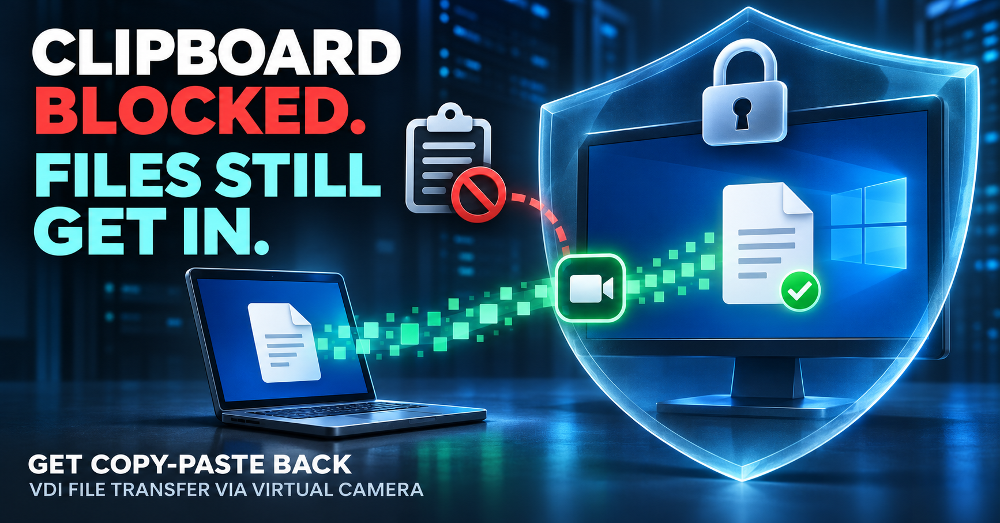
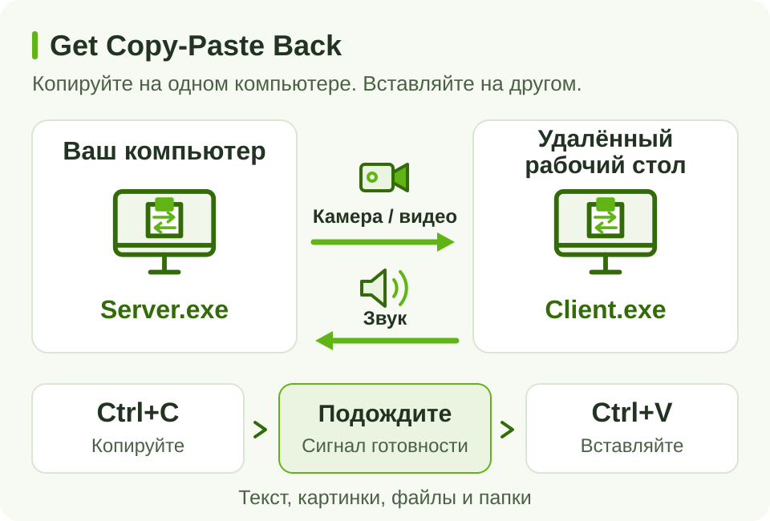
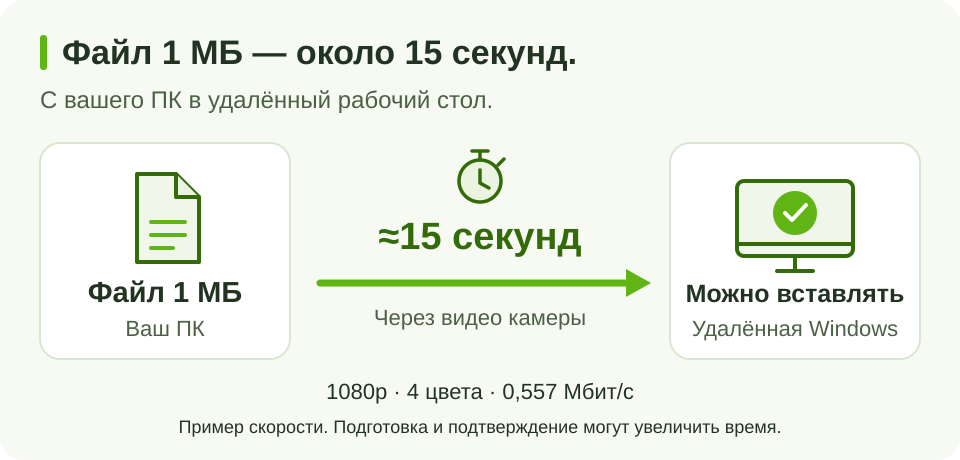
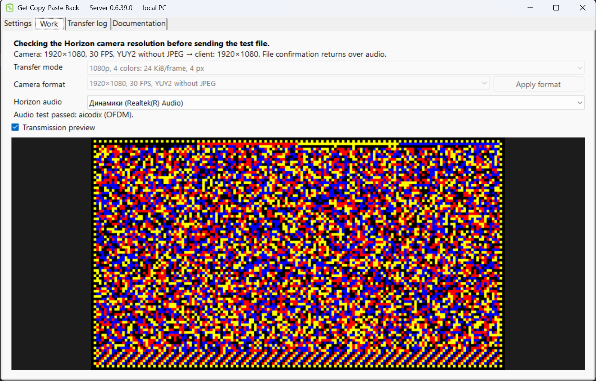
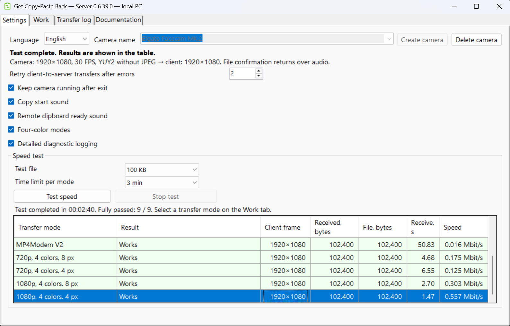

# Get Copy-Paste Back

[English](README.md) · [Скриншоты](screenshots/README.md) · [Техническое руководство](docs/TECHNICAL.ru.md)

**В удалённой Windows не работает копирование и вставка? Снова копируйте текст и файлы между своим ПК и удалённым рабочим столом.**

Get Copy-Paste Back передаёт буфер обмена через камеру и звук в вашем подключении к удалённому рабочему столу. Скопируйте через **Ctrl+C**, дождитесь сигнала готовности и вставьте через **Ctrl+V** на другой стороне. Текст, изображения, файлы и папки передаются в обе стороны.

**[Скачать готовые программы](https://github.com/AlexeySmirnov74/get-copy-paste-back/releases/latest)** — собирать проект самостоятельно не нужно.

| Где запускать | Что скачать |
| --- | --- |
| На своём ПК или ноутбуке | [Server.exe](https://github.com/AlexeySmirnov74/get-copy-paste-back/releases/latest/download/Server.exe) |
| Внутри удалённой Windows | [Client.exe](https://github.com/AlexeySmirnov74/get-copy-paste-back/releases/latest/download/Client.exe) |

Нужны **64-разрядная Windows с обеих сторон**, работающий проброс камеры и звука и права администратора для создания камеры на вашем ПК.

## Как компьютеры обмениваются данными

Сервер создаёт виртуальную камеру — направлять настоящую веб-камеру на экран не требуется.

## Совместимость с платформами

**Проверено:** VMware Horizon / Omnissa Horizon.

**Пока не проверено:** Citrix, Microsoft RDP, Azure Virtual Desktop, Windows 365 и Amazon WorkSpaces.

Ожидаем, что тот же подход будет работать, если проброшенная камера доступна приложениям Windows внутри удалённого рабочего стола, а звук удалённой Windows слышен на вашем ПК. Совместимость ещё нужно проверить на каждой платформе. Камеру и аудиовыход в **Client.exe** может потребоваться выбрать вручную.

## Первая настройка с Horizon

1. Скачайте одинаковые версии обеих программ по ссылкам выше. На каждом компьютере положите его EXE в папку, доступную для записи.
2. На своём ПК откройте **Server.exe → Settings**, выберите название камеры и нажмите **Create camera**. Разрешите доступ администратора, когда Windows спросит. Если установщик попросит перезагрузку, перезагрузите Windows и снова нажмите **Create camera**.
3. В Horizon выберите созданную камеру для проброса и переподключитесь к удалённому рабочему столу.
4. Внутри удалённой Windows запустите **Client.exe**. Нажмите правой кнопкой на зелёный значок рядом с часами Windows — он может быть скрыт под стрелкой. Клиент найдёт камеру сервера автоматически; при необходимости выберите её вручную.
5. В этом меню выберите **Audio output**, звук которого слышен на вашем ПК. Сервер должен показать **Audio test passed**. На вкладке **Work** сервера поле **Horizon audio** по умолчанию принимает звук со всех выходов.

Программы изначально открываются на английском. Русский можно включить в **Settings → Язык / Language**.

## Как копировать каждый день

**Со своего ПК в удалённую Windows:** нажмите **Ctrl+C** на своём ПК. Один короткий сигнал означает, что копирование принято. Дождитесь **двух высоких сигналов** — буфер на удалённом ПК готов. Нажмите **Ctrl+V** в удалённом рабочем столе.

**Из удалённой Windows на свой ПК:** нажмите **Ctrl+C** внутри удалённого рабочего стола. Дождитесь **двух высоких сигналов на своём ПК** и вставьте там через **Ctrl+V**.

На сервере также можно посмотреть вкладку **Transfer log / Лог передачи**. Дождитесь завершения одной передачи, прежде чем копировать следующее. Оставляйте обе программы работающими до окончания вставки.

Начните с короткого текста. Обратная передача через звук гораздо медленнее; удобнее передавать текст и небольшие файлы. Оставляйте звук модема Horizon включённым, а музыку и уведомления на время передачи выключайте. Звуковые подтверждения настраиваются в **Settings / Настройки**.

## Как выглядит программа

**Работа:** предпросмотр данных, которые идут через виртуальную камеру. По умолчанию предпросмотр выключен.

**Настройки:** создание камеры и проверка скорости, которая покажет рабочие режимы именно в вашем подключении.

Скриншоты сделаны в версии 0.6.39; последняя версия может немного отличаться. **[Посмотреть все пять скриншотов](screenshots/README.md).**

## Данные не дошли?

- **Камеры нет?** Проверьте её выбор в Horizon и в меню клиента. После смены формата камеры отключитесь от удалённого рабочего стола и подключитесь заново.
- **Нет сигнала готовности или все тесты скорости не проходят?** Проверьте **Audio output** у клиента и **Horizon audio** у сервера. Запустите **Test audio** и дождитесь сообщения об успешной проверке на сервере.
- **Вставляется прежнее содержимое?** Дождитесь доставки и посмотрите **Лог передачи**. Первый сигнал означает, что копирование принято; два высоких сигнала подтверждают готовность буфера.

## Для тех, кому нужны подробности

В **[техническом руководстве](docs/TECHNICAL.ru.md)** описаны измеренные скорости, режимы, аудиокодеки, настройки и логи, ограничения размера файлов, поиск проблем, сборка из исходников и лицензии компонентов. Там же показана идея будущих аудиоканалов.

[English instructions](README.md) · [Technical guide in English](docs/TECHNICAL.md) · [Все скриншоты](screenshots/README.md)

Независимый проект для пользователей Horizon.
