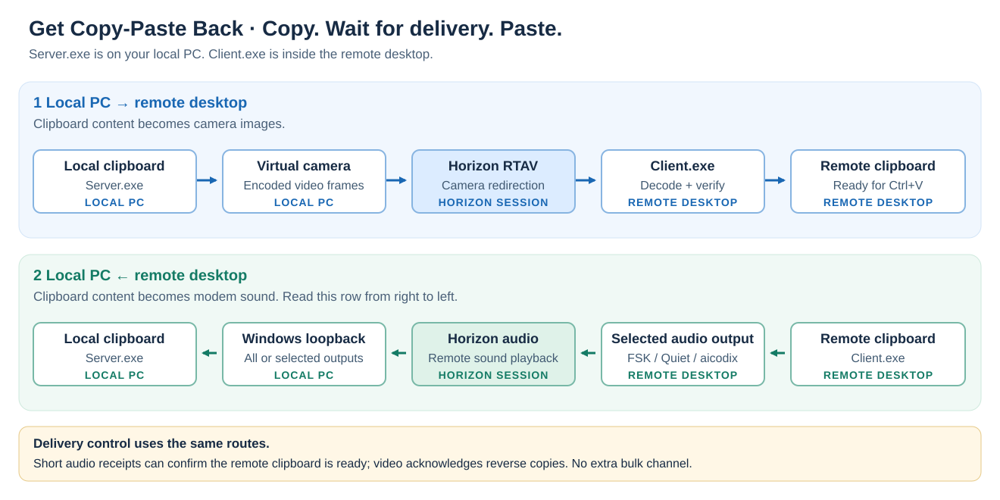
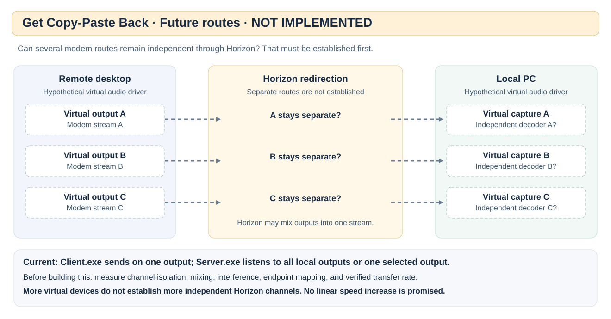

# Technical guide

[Quick start and downloads](../README.md) · [Русский](TECHNICAL.ru.md)

This guide explains Get Copy-Paste Back's setup, transport, limits, performance evidence, storage, and build process. It describes application **0.6.40**; recorded measurements keep their original context and version where known.

- [How it works](#how-it-works)
- [Setup, defaults, and camera discovery](#setup-defaults-and-camera-discovery)
- [Modes and speed](#modes-and-speed)
- [Troubleshooting](#troubleshooting)
- [Payload limits and virtual files](#payload-limits-and-virtual-files)
- [Camera lifetime](#camera-lifetime)
- [Settings, logs, and temporary files](#settings-logs-and-temporary-files)
- [Integrity, security, and limitations](#integrity-security-and-limitations)
- [Possible future audio channels](#possible-future-audio-channels)
- [Source map](#source-map)
- [Build and contribute](#build-and-contribute)
- [Component licenses](#component-licenses)

**The names describe this application's roles:** `Server.exe` runs on your **local PC**; `Client.exe` runs **inside the remote desktop**. They are separate from the Horizon infrastructure. This project does not change Horizon clipboard policies: it uses camera/audio redirection that your environment must already allow.

## How it works



- **Local → remote:** the server packages and automatically compresses supported clipboard data, draws it as video frames, and feeds its virtual camera. Horizon Real-Time Audio-Video (RTAV) redirects the camera; the client decodes and verifies the data, then prepares the remote clipboard.
- **Remote → local:** the client encodes clipboard data as modem sound on one selected audio output. Horizon redirects remote sound to the local PC; the server captures all active local playback devices by default, or one explicitly selected device, through Windows audio loopback, decodes the data, and prepares the local clipboard. Each output is decoded separately; duplicate copies are published once.
- **Delivery control:** short audio receipts can return confirmation that the remote clipboard is ready. Reverse transfers receive acknowledgements through video. These controls share the existing streams; they are not another bulk-data channel.

## Setup, defaults, and camera discovery

The setup below describes the tested VMware/Omnissa Horizon configuration. Other platforms remain unverified; see the [platform compatibility notes](../README.md#platform-compatibility).

Use matching [Server.exe for the local PC](https://github.com/AlexeySmirnov74/get-copy-paste-back/releases/latest/download/Server.exe) and [Client.exe for remote Windows](https://github.com/AlexeySmirnov74/get-copy-paste-back/releases/latest/download/Client.exe), or the ZIP containing both, from the [latest release](https://github.com/AlexeySmirnov74/get-copy-paste-back/releases/latest). Running a release requires neither the source code nor a compiler.

You need Windows x64 on both sides, a Horizon session with camera/RTAV and playback-audio redirection enabled, and permission to install the local camera's packaged driver. Keep each EXE in a writable folder. No compiler or modem utility is required to run a release; the runtime components and camera installer are packaged offline.

1. Download matching `Server.exe` and `Client.exe` from [Releases](https://github.com/AlexeySmirnov74/get-copy-paste-back/releases). Put the server on the **local PC**, and the client inside the **remote desktop**.
2. On the local PC, run `Server.exe`. In **Settings**, choose a camera name and click **Create camera**. Windows may request administrator permission. If setup reports that a restart is required, restart Windows and repeat **Create camera**.
3. In the Horizon connection, select that virtual camera for redirection. Reconnect the remote desktop if needed so it sees the camera.
4. Inside the remote desktop, run `Client.exe`. It lives in the notification area. **Settings → Automatically select server camera** is on by default: it tries the saved exact device ID first, then only cameras whose names exactly match the server's 100-name catalog. The client still verifies the application's service frames before accepting a camera. For a custom name outside the catalog, select the camera manually first; manual selection turns automatic selection off and saves that choice.
5. Set up the return sound path. On the local server's **Work** tab, **Horizon audio** defaults to **All audio outputs**. You can select just the playback device on which you hear the remote desktop instead. In the remote client's tray menu, choose **Audio output** and the redirected output. Selection sends a probe; the server displays **Audio test passed** when the entire probe arrives. Use **Test audio** to repeat it.
6. Copy a small piece of text with **Ctrl+C**. Wait for the receiving clipboard to be ready, then press **Ctrl+V** on the other side. Copy files or folders in Explorer the same way. Start with text before trying larger files.

### Automatic camera discovery in 0.6.40

Automatic discovery skips other unsaved camera names, including **Chicony USB2.0 Camera**. A physical camera with a catalog name can still activate briefly: the name filters candidates, it does not prove their identity. Each candidate gets a finite pass through up to five DirectShow/Media Foundation compatibility modes. To retry an exhausted candidate, turn automatic selection off and on, or restart the client; a new device ID can still be discovered later.

The limit is **five capture opens per exact device ID** in an automatic discovery cycle, including compatibility retries and source-format refreshes while the candidate is unverified. A failed candidate stays exhausted through later device-list refreshes and disappearance/reappearance of that same ID. Switching automatic selection off and on, or restarting the client, starts a fresh cycle; a newly appearing ID has its own budget.

The available compatibility modes, in their initial retry order, are DirectShow's highest offered format up to 1920×1080, Media Foundation's highest native format, DirectShow's driver default, Media Foundation's driver default, and DirectShow 1280×720. A failure before receiving frames advances the mode; a failure after frames can retain the current mode. Failures use increasing delays of 3, 5, 10, 20, and at most 30 seconds. An automatic probe must receive validated application control within five seconds. The DirectShow open/start operations have their own finite 15/10-second waits, so discovery is not a five-second total wall-clock operation. A manually selected camera has separate recovery checks for no first frame within 20 seconds or a 15-second interruption in frames.

Only validated hello, camera-format, or acknowledgement control proves an automatic candidate. During a probe, decoded content cannot publish a clipboard, start reverse audio, acknowledge transfers, or prepare received files. Successful proof saves that exact ID. Manual camera selection turns automatic selection off and persists even for a custom name. See [automatic selection](../src/ReceiverContext.AutoCamera.cs), [retry policy](../src/CaptureRetryPolicy.cs), and [capture coordination](../src/ReceiverContext.cs).

### Status sounds and defaults

The server's **Copy start sound** (one short beep) means a new local copy was accepted for preparation. **Remote clipboard ready sound** (two higher beeps) means the client confirmed verified delivery and clipboard publication. These sounds are on by default and can be disabled independently; audio modem traffic is separate from those cues. A new copy can replace a pending transfer, so wait for delivery before copying the next item.

The first-run language is **English**. Change it in **Settings → Язык / Language** on either application. Existing preferences are retained. The defaults are **1080p robust** transfer mode, **1920×1080 YUY2 at 30 FPS**, **aicodix** audio modem, automatic client camera selection on, transmission preview off, and **Keep camera running after exit** on.

### Audio routes and retry policy

Audio selections are saved and restored when the selected devices are available. The server keeps an explicit device or Windows-default choice instead of reverting to all outputs after restart. If an output is temporarily unavailable, check that it has reappeared and select the intended Horizon sound route; changing a device's enumeration position must not send data through an unrelated output. Listening to all local outputs improves route discovery; it does not multiply Horizon's return bandwidth.

The server stores stable WASAPI endpoint IDs. A missing `audioOutput` setting means `all_render` (all active render outputs); an explicitly empty value preserves Windows-default routing. Failed or empty enumeration does not erase a saved selection. Each captured endpoint has its own decoder; PCM from different endpoints is never mixed by the application, and shared packet deduplication prevents publishing the same transfer twice.

The client's `audio.id` keeps endpoint/name lines and, when available, a third stable identity line. Restoration prefers explicit identity; an old device name migrates only when it is unique. A numeric WinMM index must not be reused for a different device. A failed probe or temporarily missing device does not erase the explicit preference.

The server setting **Retry client-to-server transfers after errors** permits **0–10 additional passes**, default **2** (at most three passes in total). It is announced to the client over the verified video control path. Reverse-transfer acknowledgements stop the pending audio work; after the allowed passes, the sender gives the final audio up to five seconds for a video acknowledgement. Partial reception can survive an interruption, while session/transfer identity and duplicate checks prevent unrelated data from being joined. New copies and explicit output/modem changes can cancel or supersede pending work. More retries can help with losses but consume more time.

The three offered audio modems are managed **Compatible FSK**, native **Quiet (OFDM)**, and native **aicodix (OFDM)**. The last is the default. These modes encode data as audible sound; playback volume, mute, other sounds, audio processing, and Horizon's audio codec affect reception. Use the probe to validate the actual route. Listening to multiple local outputs does not create independent transmission channels.

## Modes and speed

There are **five video modes by default**. To add four color modes to **Work → Transmission mode** and the speed test, enable **Settings → Four-color modes**. This checkbox is **off by default** and its choice is saved. Turning it off leaves the original five modes available. Both sides need the current EXEs for color transfer.

The color checkbox changes only the offered transmission modes and speed-test set. It does not change YUY2 source formats or the client's compatible decoders. An explicit saved `colorModesEnabled=false` takes precedence; a legacy saved experimental color selection enables migration only when there is no explicit choice. A running speed test retains the mode set with which it started. Changing packet size starts a fresh transfer identity, including when disabling color during a pending copy.

### Video formats and calculated capacity

Camera source formats remain **640×480, 1280×720, and 1920×1080 YUY2 at 30 FPS**. Transfer mode and camera format are separate choices: a smaller redirected image can damage a mode's finer cells. There is no offered 2K/4K camera mode. Enabling color modes does not install or change a camera driver.

YUY2 avoids local JPEG encoding. Horizon may still compress or scale RTAV video, so raw camera bandwidth does not describe clipboard payload throughput.

The figures below are **calculated payload ceilings at 30 data frames/s**, using the source protocol's payload capacity. They exclude service frames, repeat rounds, losses, image scaling, compression, and delivery confirmation. They are **not measured Horizon throughput**.

| Video mode in the UI | Encoded image | Payload per data frame | Calculated ceiling |
| --- | --- | ---: | ---: |
| 720p: 1.5 KiB/frame | 1280×720 | 1,536 bytes | 368.64 kbit/s |
| 720p dense: 6 KiB/frame | 1280×720 | 6,144 bytes | 1,474.56 kbit/s |
| 1080p robust: 4-pixel cells | 1920×1080 | 12,288 bytes | 2,949.12 kbit/s |
| 640p: 7 blocks/frame | 640×480 | 1,792 bytes | 430.08 kbit/s |
| MP4Modem V2: error correction | 1280×720 | 1,082 bytes | 259.68 kbit/s |
| Color 720p: 8-pixel cells, optional | 1280×720 | 3,072 bytes | 737.28 kbit/s |
| Color 720p: 4-pixel cells, optional | 1280×720 | 12,288 bytes | 2,949.12 kbit/s |
| Color 1080p: 8-pixel cells, optional | 1920×1080 | 6,144 bytes | 1,474.56 kbit/s |
| Color 1080p: 4-pixel cells, optional | 1920×1080 | 24,576 bytes | 5,898.24 kbit/s |

`ceiling = payload bytes/frame × 30 × 8`. MP4Modem V2 uses an adapted waveform and error correction; it does not send MP4 files or use an MP4 container.

Color modes use black, red, yellow and blue cells to carry **two bits per cell**. Reference colors in each frame calibrate decoding; metadata and payload share a CRC32 check. They require the redirected video to preserve enough color detail. Larger nominal capacity does not guarantee a faster connection: use the verified speed test to choose a working mode.

### Measured one-session examples

An earlier documented real Horizon session capturing **1920×1080** produced these **100 KiB verified-file test results**. They measure file reception time, excluding the wait for the return audio report; they are examples from that session, not guaranteed rates:

| Mode | Observed file rate |
| --- | ---: |
| 720p color, 8-pixel cells | 0.151 Mbit/s |
| 720p color, 4-pixel cells | 0.763 Mbit/s |
| 1080p color, 8-pixel cells | 0.246 Mbit/s |
| 1080p color, 4-pixel cells | 0.597 Mbit/s |
| 1080p robust, monochrome | 0.435 Mbit/s |

A separate [screenshot from application 0.6.39](../screenshots/sc3.png) records another **100 KiB (102,400-byte), one-session verified-file test**. It reports **9/9 passed**, but only the following five result rows are visible. These are measured local-to-remote file rates from that session; they are not guaranteed rates or measurements of the reverse audio path.

| Visible mode in the 0.6.39 screenshot | Verified bytes | Reception time | Observed file rate |
| --- | ---: | ---: | ---: |
| MP4Modem V2 | 102,400 / 102,400 | 50.83 s | 0.016 Mbit/s |
| Color 720p, 8-pixel cells | 102,400 / 102,400 | 4.68 s | 0.175 Mbit/s |
| Color 720p, 4-pixel cells | 102,400 / 102,400 | 6.55 s | 0.125 Mbit/s |
| Color 1080p, 8-pixel cells | 102,400 / 102,400 | 2.70 s | 0.303 Mbit/s |
| Color 1080p, 4-pixel cells | 102,400 / 102,400 | 1.47 s | 0.557 Mbit/s |

The different ordering of modes across these two sessions shows why calculated capacity and an example rate cannot replace a test of your own connection.

### Synthetic audio comparison

The audio comparison uses the same **8,193-byte synthetic payload**, before clipboard packaging/compression. Quiet and aicodix figures come from the **0.6.31 clean PCM encode/decode validation**, including each native batch's managed 0.5-second tail. FSK is calculated from production framing: 32 full 256-byte packets and one 1-byte packet at 1,200 baud, with preambles, headers, CRC, and guards.

| Audio modem | Audio duration | Net payload rate | Evidence |
| --- | ---: | ---: | --- |
| Compatible FSK | 83.455 s | 785.38 bit/s | Calculated PCM framing |
| Quiet (OFDM) | 34.503 s | 1,899.64 bit/s | Synthetic clean PCM roundtrip |
| aicodix (OFDM), default | 24.033 s | 2,727.21 bit/s | Synthetic clean PCM roundtrip |

Short messages have proportionally more overhead. These are generated-audio durations, not CPU benchmark times, and include no Horizon codec, audio-device latency, retries, or acknowledgements. They do not establish performance through a physical Horizon deployment. No 100 Mbit/s transfer rate is claimed.

### Testing your own connection

For your own connection, use **Settings → Speed test**, starting with the default **10 KB**. The test checks the five standard modes, or all nine when **Four-color modes** is enabled, and reports verified bytes and reception time; waiting for the return audio report is excluded. A 100 MB speed-test option is synthetic benchmark traffic, not a larger clipboard limit. Compression can improve apparent speed for repetitive text; ZIP, JPEG, and video usually benefit much less.

## Troubleshooting

| Symptom | Check |
| --- | --- |
| The client cannot find the camera | Enable camera redirection in Horizon, reconnect, and check the server's camera name. After deleting/recreating the camera, select the new device in Horizon and, if using manual selection, in the client. |
| The picture arrives but data does not decode | Try **1080p robust** or **640p**; check the received camera resolution. After applying a different source format, reconnect Horizon. |
| Audio probe or return copies fail | Confirm both selected playback outputs form the same Horizon sound route. Check volume/mute and try another **Audio modem** in the client's tray menu. Other sound and audio processing can interfere with modem audio. |
| Every speed-test mode fails or times out | First check **Audio output** in the remote client's tray and **Horizon audio** on the local server. Run **Test audio** and wait for the server's success notice: test results and delivery confirmations need that return path even when the camera shows video. Then check camera selection and actual capture resolution. |
| A copy started but paste is still old | Wait for delivery confirmation or inspect transfer status. The start sound alone does not indicate delivery. |

## Payload limits and virtual files

Supported content is Unicode text, HTML/RTF clipboard text, bitmap images, and Explorer file/folder copies. Other application-specific clipboard formats are not transferred. Transfers are bounded to **32 MiB** of serialized and decoded content, including metadata, with at most **4,096 file/folder entries** and bounded nesting.

The remote client keeps received files **in memory**, exposes them as Windows virtual clipboard files, and creates no `Received` directory or intermediate received-file copies. Keep the client running until pasting finishes. File Explorer writes the files into the destination you choose; applications accepting only filesystem clipboard paths may not support virtual files. Files arriving back at the local server retain its existing disk staging. The reverse audio path is especially slow for large files.

The client implements Shell `FileGroupDescriptorW` / `FileContents` with independent in-memory streams; it does not publish `CF_HDROP` filesystem paths. Clipboard-busy publication is retried, and delivery confirmation follows successful publication. Neither the start cue nor merely receiving some video frames proves that a paste is ready.

## Camera lifetime

Closing or minimizing the server window sends it to the tray. Use **Exit** there to close the application. With the default **Keep camera running after exit**, its camera/bridge helpers remain available; uncheck it to stop them on exit. **Delete camera** removes the application's camera regardless of this setting.

## Settings, logs, and temporary files

For compatibility with earlier releases, the existing folder names are retained: server settings/logs are under `HorizonServer/data` beside `Server.exe`, received files under `HorizonServer/Received`. Client settings use a writable `HorizonClient/Settings` folder under LocalAppData, then Roaming AppData, then the EXE directory as a fallback. Client audio DLLs are extracted from the EXE into that settings directory's `audio-native` child (normally `%LOCALAPPDATA%\HorizonClient\Settings\audio-native`). Client logs remain beside `Client.exe`; the client serves received files from memory until the clipboard is replaced or the client exits. Existing received files or user-provided DLLs from earlier versions are not deleted automatically. Detailed logging defaults to on for the server and off for the client. Review and redact logs before sharing them.

The client migrates recognized legacy settings from beside the EXE only when the destination setting is absent. Settings include `camera.id`, `camera.auto`, `camera.resolution`, `audio.id`, `audio.modem`, language, and the debug-log preference. Choosing a writable settings directory can briefly create and remove an owned probe file; migration can create an owned temporary file before moving it into place. Those settings operations do not stage received clipboard files. The server also writes its settings through an owned temporary file before replacement.

Do not delete a user's old `Received` files, custom DLLs, settings, or runtime folder when upgrading or preparing a release. Keep these personal runtime contents outside published artifacts.

Get Copy-Paste Back was previously named **Horizon-Enable-CopyPaste**. The public programs are now `Server.exe` and `Client.exe`; existing C# namespaces, embedded-resource identifiers, native component names and helper filenames retain their compatibility names. Keep the server beside its existing runtime folder when upgrading, and use matching server/client versions.

## Integrity, security, and limitations

Video/audio packet CRCs reject damaged frames. The serialized clipboard envelope verifies its declared decoded length and SHA-256 digest before publication. Reassembly is bounded, rejects conflicting duplicates, and keeps transfer/session binding; cancellation and clipboard echo suppression prevent stale work and a received copy being sent straight back.

File validation rejects rooted paths, traversal components, invalid or duplicate names, missing parent directories, unsupported links/reparse points, and paths that escape the server's staging directory. File collection has a maximum nesting depth of 64; relative paths are limited to 220 characters. The serialized, encoded, and decompressed payloads remain bounded by the application limit, including metadata.

These integrity checks are not encryption or cryptographic authentication of a peer. A camera name is a candidate filter and wire validation proves compatible protocol data, not the identity of a person or machine. Use the application only where camera/audio redirection and the transferred content are permitted. The program does not alter Horizon clipboard policies, install components inside Horizon infrastructure, or provide an independent network channel.

Camera scaling/compression can corrupt fine cells; sound mixing, mute, processing, latency, and losses can prevent audio reception. A successful synthetic fixture or clean PCM roundtrip establishes behavior under those fixture conditions. It does not establish real Horizon throughput or guarantee delivery on another session.

## Possible future audio channels



This is a **design possibility, not an implemented feature or a speed promise**. Virtual audio drivers on both sides could provide separate modem routes only if Horizon preserves them as independent channels. Horizon may redirect several outputs into one mixed stream. Independence, interference, endpoint mapping, and real transfer rate must be tested before any claim that additional channels increase speed. The client sends through one selected audio output; the server can listen to all local outputs or one selected output.

## Source map

The managed application shares sources under [src/](../src). [Build.ps1](../scripts/Build.ps1) compiles them as `Server.exe` with `HORIZON_SERVER` and as `Client.exe` without it. Keep C# 5 compatibility; there is no assumed solution file or modern SDK build.

| Responsibility | Main sources |
| --- | --- |
| Bounded clipboard serialization, automatic DEFLATE compression, digest checks, path validation, server file staging | [ClipboardPayload.cs](../src/ClipboardPayload.cs) |
| Client virtual clipboard files, independent streams, OLE storage-medium ownership | [MemoryFileClipboard.cs](../src/MemoryFileClipboard.cs) |
| Visual packets, framing, calibration, CRC, reassembly | [VisualProtocol.cs](../src/VisualProtocol.cs), [DenseVideoProtocol.cs](../src/DenseVideoProtocol.cs), [Mp4ModemProtocol.cs](../src/Mp4ModemProtocol.cs), [ColorVideoProtocol.cs](../src/ColorVideoProtocol.cs) |
| Managed FSK and native Quiet/aicodix adapters | [AudioModem.cs](../src/AudioModem.cs), [AudioTransport.cs](../src/AudioTransport.cs), [NativeAudioCodec.cs](../src/NativeAudioCodec.cs), [AudioPacketWire.cs](../src/AudioPacketWire.cs), [native/audio/](../native/audio) |
| Audio data/control coordination | [ClientAudioBridge.cs](../src/ClientAudioBridge.cs), [ServerAudioBridge.cs](../src/ServerAudioBridge.cs) |
| Shared 100-name catalog and bounded automatic discovery | [CameraNames.cs](../src/CameraNames.cs), [ReceiverContext.AutoCamera.cs](../src/ReceiverContext.AutoCamera.cs), [CaptureRetryPolicy.cs](../src/CaptureRetryPolicy.cs) |
| Server window and tray client | `ServerForm.*.cs`, `ReceiverContext*.cs` in [src/](../src) |
| Settings paths and offline runtime/driver lifecycle | [ClientPaths.cs](../src/ClientPaths.cs), [ServerRuntime.cs](../src/ServerRuntime.cs), [DriverInstaller.cs](../src/DriverInstaller.cs), [camera backend](../native/usbbridge) |

The Rust camera backend has its own component version, separate from the application's release version. The shared green application icon is [HorizonClient.ico](../assets/HorizonClient.ico); its SVG source and [Build-AppIcon.ps1](../scripts/Build-AppIcon.ps1) generator keep icon regeneration offline. Preserve compatibility namespaces, resource IDs, runtime/helper names, component copyright notices, and historical release-note names. Update English and Russian UI/documentation together.

## Build and contribute

The application is C# 5 / Windows Forms, built with the Windows x64 **.NET Framework 4.x compiler**; this is not a `dotnet build` project. Native audio uses C/C++, and the local camera backend is Rust. See [AGENTS.md](../AGENTS.md) for the source map, safe tests, and release checks.

### Managed build prerequisites

The compiler is `%WINDIR%/Microsoft.NET/Framework64/v4.0.30319/csc.exe`, using Windows Forms and System.Drawing. Before compilation, the runtime inputs must exist: `horizon-quiet.dll`, `horizon-aicodix.dll`, `quiet-source.zip`, and `quiet-relink.zip` under `runtime/audio/`, the camera backend, and the pinned signed driver installer.

Prebuilt native/runtime inputs are included in the public repository, so the ordinary managed build works offline after cloning. From the repository root in Windows PowerShell:

```powershell
# When the packaged native/runtime inputs are already present:
powershell.exe -NoProfile -ExecutionPolicy Bypass -File scripts\Build.ps1 -NoPublish
```

That builds both EXEs into `build/` and runs the synthetic/fixture suite. Omitting `-NoPublish` also copies release files into `dist/`; `-SkipTests` is for local iteration, not release validation. It compiles camera/audio smoke utilities without running them.

PowerShell 5.1 needs a UTF-8 BOM on scripts containing non-ASCII text. The managed build checks owned files in `scripts/` and `tests/` before compilation; keep that preflight enabled so English and Russian Windows interpret fixtures consistently.

### Rebuilding native components

To rebuild native inputs, install Visual Studio C++ x64 Build Tools plus Windows SDK, Rust with Cargo/rustfmt/Clippy for the MSVC x64 target, CMake, and Ninja. Fetch the locked Rust dependencies once before the offline native build. Quiet downloads and verifies a pinned LLVM-MinGW toolchain if it is absent; the aicodix source is vendored.

The Rust build also needs the five WebView2 SDK cache files listed in [webview2-sdk.json](../native/usbbridge/webview2-sdk.json). Populate that cache from the pinned Microsoft NuGet package, checking its package and member SHA-256 values before the offline build; the SDK cache is excluded from Git. See [native backend build notes](../native/usbbridge/HORIZON-NATIVE.md). This is unnecessary for the ordinary managed build using the included backend EXE.

```powershell
cargo fetch --locked --manifest-path native\usbbridge\Cargo.toml
powershell.exe -NoProfile -ExecutionPolicy Bypass -File native\usbbridge\Build-HorizonNative.ps1
powershell.exe -NoProfile -ExecutionPolicy Bypass -File scripts\Build-AudioNative.ps1
powershell.exe -NoProfile -ExecutionPolicy Bypass -File scripts\Build.ps1 -NoPublish
```

The native backend helper runs formatting, selected synthetic tests, Clippy, and the release backend build using offline, locked dependencies. The audio helper builds/tests both codecs and copies their required payloads to `runtime/audio/`; the optional Quiet toolchain is pinned and SHA-256 verified under `build/`. Keep dependency pins unchanged unless making an explicit dependency update.

### Validation and release packaging

The server build also needs the unchanged signed camera-driver installer at `runtime/drivers/USBip-0.9.8.1-x64.exe`; preserve its version, provenance, and notices. Dependency/toolchain downloads for native rebuilds are separate from the packaged application's offline operation. Do not run setup, driver repair, smoke capture, or clipboard/audio hardware tests as routine automated validation.

For release packages, checksums, and publishing, follow [RELEASING.md](RELEASING.md). The release helpers and tag workflow keep this separate from ordinary local builds.

Use isolated synthetic inputs and fake endpoints for routine protocol, lifetime, interoperability, and validation tests. Fixture tests can create dedicated temporary files or hidden forms with injected clocks/services. The normal applications, driver installers/repair/setup/removal, hardware smoke tools, real camera/audio enumeration or capture, clipboard listeners/hooks, UAC, services, and certificate operations are real system actions, not routine implementation checks. Perform them only as an explicitly authorized system task.

For a release, update both conditional assembly-version branches in [AssemblyInfo.cs](../src/AssemblyInfo.cs) and add bilingual versioned notes. [Package-Release.ps1](../scripts/Package-Release.ps1) runs or verifies a full managed validation, checks matching binaries and build-input fingerprints, and creates the allowlisted ZIP (`Server.exe`, `Client.exe`, `START-HERE.txt`) plus SHA-256 checksums. Do not package active runtime directories, saved settings, logs, received files, camera identity/session data, keys, credentials, caches, personal names/paths, or unrelated executables.

The [release tag workflow](../.github/workflows/release.yml) rebuilds/tests the exact tag and publishes four assets: `Server.exe`, `Client.exe`, the versioned ZIP, and `SHA256SUMS.txt`. Verify the published tag, workflow result, downloaded files, and checksums before reporting a release complete. Do not force-push history or move existing release tags. The complete procedure and verified-local-package fallback are in [RELEASING.md](RELEASING.md).

## Component licenses

A blanket license for the original Get Copy-Paste Back application has not been specified. Do not infer an MIT grant for the entire repository from a component's license. Preserve the existing component terms: [USBBridge](../native/usbbridge/LICENSE), [MP4Modem port and upstream materials](../third_party/mp4modem/README.md), [Quiet and dependencies, including LGPL-2.1 libfec](../third_party/quiet/README.txt), [aicodix and dependencies](../third_party/aicodix/README.txt), and [driver/runtime notices](../runtime/THIRD-PARTY.txt).

Each release EXE embeds the relevant notices and audio corresponding-source/relink materials. Export them explicitly to a folder you choose:

```powershell
.\Server.exe --export-third-party "C:\GetCopyPasteBackMaterials"
# Or use Client.exe with the same arguments.
```

Normal startup does not automatically export a license/source folder. This project is independent of the Horizon product and its vendor.
