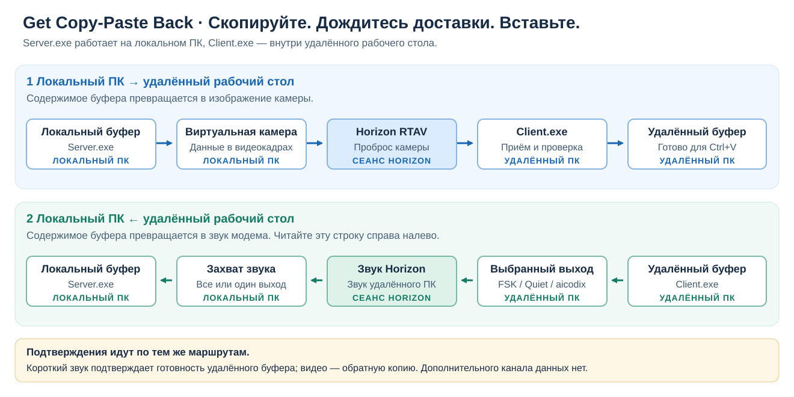
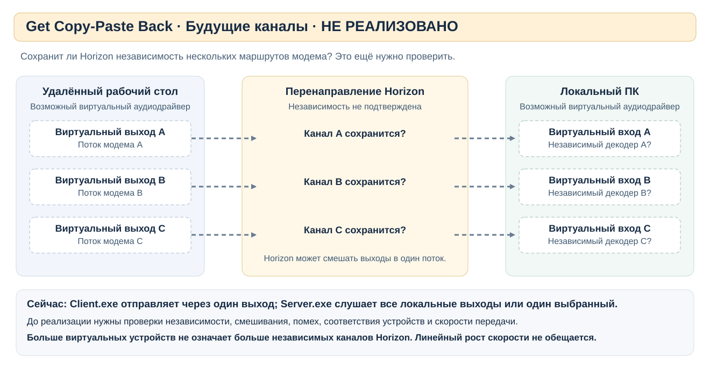

# Техническое руководство

[Краткая инструкция и скачивание](../README.ru.md) · [English](TECHNICAL.md)

Здесь подробно описаны настройка Get Copy-Paste Back, передача данных, ограничения, измерения скорости, хранение и сборка. Руководство относится к приложению **0.6.40**; у результатов измерений сохранены исходные условия и версия, если она известна.

- [Как это работает](#как-это-работает)
- [Настройка, значения по умолчанию и поиск камеры](#настройка-значения-по-умолчанию-и-поиск-камеры)
- [Режимы и скорость](#режимы-и-скорость)
- [Устранение неполадок](#устранение-неполадок)
- [Ограничения данных и виртуальные файлы](#ограничения-данных-и-виртуальные-файлы)
- [Жизненный цикл камеры](#жизненный-цикл-камеры)
- [Настройки, логи и временные файлы](#настройки-логи-и-временные-файлы)
- [Целостность, безопасность и ограничения](#целостность-безопасность-и-ограничения)
- [Возможные будущие аудиоканалы](#возможные-будущие-аудиоканалы)
- [Карта исходников](#карта-исходников)
- [Сборка и участие](#сборка-и-участие)
- [Лицензии компонентов](#лицензии-компонентов)

**Имена относятся к ролям этой программы:** `Server.exe` запускается на **локальном ПК**, `Client.exe` — **внутри удалённого рабочего стола**. Это отдельные приложения, не серверы инфраструктуры Horizon. Программа не меняет политики буфера обмена Horizon: ей нужны разрешённые в вашей среде перенаправление камеры и звука.

## Как это работает



- **Локальный → удалённый:** сервер упаковывает и автоматически сжимает поддерживаемое содержимое буфера, превращает его в видеокадры и подаёт в виртуальную камеру. Horizon Real-Time Audio-Video (RTAV) перенаправляет камеру. Клиент декодирует и проверяет данные, затем подготавливает удалённый буфер обмена.
- **Удалённый → локальный:** клиент кодирует содержимое буфера в звук модема и воспроизводит его через один выбранный аудиовыход. Horizon передаёт удалённый звук на локальный ПК; сервер по умолчанию слушает все активные устройства воспроизведения через Windows loopback, либо одно выбранное устройство, декодирует данные и подготавливает локальный буфер. Каждый выход декодируется отдельно; одинаковые копии публикуются один раз.
- **Подтверждения:** короткие звуковые сообщения могут подтверждать готовность удалённого буфера. Подтверждения обратной передачи идут по видео. Это служебные сообщения в существующих потоках, а не дополнительный канал для больших данных.

## Настройка, значения по умолчанию и поиск камеры

Ниже описана проверенная настройка VMware/Omnissa Horizon. Другие платформы пока не проверены; см. [описание совместимости](../README.ru.md#совместимость-с-платформами).

Используйте одинаковую версию [Server.exe для локального ПК](https://github.com/AlexeySmirnov74/get-copy-paste-back/releases/latest/download/Server.exe) и [Client.exe для удалённой Windows](https://github.com/AlexeySmirnov74/get-copy-paste-back/releases/latest/download/Client.exe), либо ZIP с обоими файлами, из [последнего релиза](https://github.com/AlexeySmirnov74/get-copy-paste-back/releases/latest). Для запуска релиза не нужны исходный код и компилятор.

Нужны Windows x64 с обеих сторон, сеанс Horizon с разрешёнными камерой/RTAV и воспроизведением удалённого звука, а также право установить комплектный драйвер камеры на локальном ПК. Поместите каждый EXE в доступную для записи папку. Для запуска релиза не нужны компилятор или отдельная утилита модема: компоненты и установщик камеры входят в автономный комплект.

1. Скачайте одинаковую версию `Server.exe` и `Client.exe` со страницы [Releases](https://github.com/AlexeySmirnov74/get-copy-paste-back/releases). Сервер поместите на **локальный ПК**, клиент — **внутрь удалённого рабочего стола**.
2. На локальном ПК запустите `Server.exe`. В **Настройки** выберите имя камеры и нажмите **Создать камеру**. Windows может запросить права администратора. Если установщик сообщил о необходимости перезагрузки, перезагрузите Windows и повторите **Создать камеру**.
3. В подключении Horizon выберите созданную виртуальную камеру для перенаправления. При необходимости переподключите рабочий стол, чтобы камера появилась внутри него.
4. В удалённом рабочем столе запустите `Client.exe`. Он работает в области уведомлений. **Настройки → Автоматически выбирать камеру сервера** включено по умолчанию: сначала проверяется сохранённый точный ID устройства, затем только камеры, чьи имена точно совпадают с каталогом из 100 имён сервера. Перед принятием камеры клиент проверяет служебные кадры приложения. Камеру с произвольным именем вне каталога сначала выберите вручную; ручной выбор отключает автоматический и сохраняется.
5. Настройте обратный звук. На вкладке **Работа** локального сервера в **Звук Horizon** по умолчанию выбраны **Все аудиоустройства вывода**. Вместо этого можно выбрать одно устройство, через которое слышен удалённый рабочий стол. В трее удалённого клиента откройте **Аудиовыход** и выберите перенаправляемый выход. Выбор отправит пробный сигнал; после полного приёма сервер покажет **Тест аудио прошёл успешно**. Для повтора нажмите **Проверить звук**.
6. Скопируйте короткий текст через **Ctrl+C**. Дождитесь готовности буфера получателя и нажмите **Ctrl+V** на другой стороне. Файлы и папки копируются из Проводника так же. Начните с текста, затем проверяйте большие файлы.

### Автоматический поиск камеры в 0.6.40

Автопоиск пропускает остальные несохранённые имена камер, включая **Chicony USB2.0 Camera**. Физическая камера с именем из каталога всё ещё может ненадолго включиться: имя отбирает кандидата, но не подтверждает его назначение. Для каждого кандидата выполняется конечный проход не более чем по пяти режимам совместимости DirectShow/Media Foundation. Чтобы повторить исчерпанный проход, выключите и включите автовыбор либо перезапустите клиент; устройство с новым ID может быть обнаружено позднее.

Лимит — **пять открытий захвата на точный ID устройства** за цикл автопоиска. В него входят повторы совместимости и обновления формата, пока кандидат ещё не подтверждён. Исчерпание сохраняется при последующих обновлениях списка, исчезновении и повторном появлении того же ID. Выключение и включение автовыбора либо перезапуск клиента начинают новый цикл; новый ID получает собственный бюджет.

Доступные режимы совместимости в исходном порядке повторов: максимальный предлагаемый DirectShow-формат до 1920×1080, максимальный нативный формат Media Foundation, формат драйвера DirectShow по умолчанию, формат драйвера Media Foundation по умолчанию и DirectShow 1280×720. Ошибка до получения кадров переключает режим; после получения кадров текущий режим может сохраняться. После ошибок используются возрастающие задержки: 3, 5, 10, 20 и не более 30 секунд. Автопроба должна получить проверенное служебное сообщение приложения за пять секунд. Операции открытия/запуска DirectShow имеют отдельные конечные ожидания 15/10 секунд, поэтому весь поиск не ограничивается пятью секундами реального времени. Для вручную выбранной камеры отдельно проверяются отсутствие первого кадра за 20 секунд и перерыв поступления кадров на 15 секунд.

Автоматический кандидат подтверждается только проверенным hello, сообщением формата камеры или подтверждением передачи. При пробе декодированное содержимое не публикуется в буфер, не запускает обратное аудио, не подтверждает передачи и не подготавливает полученные файлы. После проверки точный ID сохраняется. Ручной выбор отключает автовыбор и сохраняется, в том числе для произвольного имени. См. [автовыбор](../src/ReceiverContext.AutoCamera.cs), [политику повторов](../src/CaptureRetryPolicy.cs) и [управление захватом](../src/ReceiverContext.cs).

### Звуковые сигналы и значения по умолчанию

**Звук начала копирования** на сервере (один короткий сигнал) означает, что новая локальная копия принята в подготовку. **Звук готовности буфера на удалённом ПК** (два более высоких сигнала) означает, что клиент подтвердил проверенную доставку и запись в буфер. Оба звука по умолчанию включены и отключаются независимо; звук самого модема — отдельная часть передачи. Новая копия может заменить ожидающую передачу, поэтому дождитесь доставки перед следующим копированием.

При первом запуске язык — **English**. Он меняется через **Settings / Настройки → Язык / Language** в каждом приложении. Сохранённый выбор учитывается. Остальные значения по умолчанию: режим **1080p устойчивый**, источник **1920×1080 YUY2, 30 кадров/с**, аудиомодем **aicodix**, автовыбор камеры клиента включён, предпросмотр выключен, **Оставлять камеру работающей после выхода** включено.

### Маршруты звука и повторы

Выбранные аудиоустройства сохраняются и восстанавливаются при следующем запуске, если доступны. Сервер сохраняет ручной выбор устройства или устройства Windows по умолчанию, не заменяя его на все выходы после перезапуска. Если выход временно отсутствовал, проверьте, что он снова появился, и выберите нужный маршрут звука Horizon. Изменение номера устройства в списке не должно направлять данные на посторонний выход. Приём со всех локальных выходов помогает найти маршрут звука, но не увеличивает пропускную способность Horizon.

Сервер хранит стабильные ID конечных устройств WASAPI. Отсутствующий параметр `audioOutput` означает `all_render` (все активные выходы); явно пустое значение сохраняет маршрут Windows по умолчанию. Ошибка или пустой результат перечисления не стирают сохранённый выбор. Для каждого захватываемого выхода работает свой декодер; приложение не смешивает PCM разных устройств, а общая проверка дубликатов не даёт опубликовать одну передачу дважды.

В клиентском `audio.id` сохраняются строки устройства/имени и, если доступна, третья строка стабильного идентификатора. Сначала восстанавливается явный идентификатор; старое имя переносится только при единственном совпадении. Числовой индекс WinMM не должен использоваться для другого устройства. Неудачная проба или временное отсутствие устройства не стирают явное предпочтение.

Настройка сервера **Повторы обратной передачи от клиента в случае ошибок** задаёт **0–10 дополнительных проходов**, по умолчанию **2** (не более трёх проходов всего). Она передаётся клиенту по проверенному служебному видеоканалу. Подтверждение обратной передачи останавливает ожидающую аудиоработу; после разрешённых проходов отправитель ждёт видеоподтверждение последнего звука до пяти секунд. Частично принятые данные могут сохраняться после перерыва, а привязка к сеансу/передаче и проверка дубликатов не дают объединять посторонние данные. Новое копирование и явная смена выхода/модема могут отменить или заменить ожидающую работу. Повторы помогают при потерях, но увеличивают время.

Предлагаются три аудиомодема: управляемый **Совместимый FSK**, нативный **Quiet (OFDM)** и нативный **aicodix (OFDM)**. Последний выбран по умолчанию. Данные передаются слышимым звуком; на приём влияют громкость, отключение звука, другие звуки, обработка аудио и кодек Horizon. Проверяйте реальный маршрут пробным сигналом. Приём с нескольких локальных выходов не создаёт независимых каналов передачи.

## Режимы и скорость

По умолчанию доступны **пять видеорежимов передачи**. Чтобы добавить четыре цветных режима в **Работа → Режим передачи** и проверку скорости, включите **Настройки → Цветные режимы (4 цвета)**. По умолчанию галочка **выключена**, её выбор сохраняется. После выключения остаются пять обычных режимов. Для цветной передачи нужны актуальные EXE с обеих сторон.

Галочка цветных режимов меняет только предлагаемые режимы передачи и набор проверки скорости. Она не меняет форматы источника YUY2 и совместимые декодеры клиента. Явно сохранённое `colorModesEnabled=false` имеет приоритет; сохранённый экспериментальный цветной режим включает перенос только при отсутствии явного выбора. Уже запущенная проверка скорости сохраняет исходный набор режимов. Изменение размера пакета начинает передачу с новым идентификатором, в том числе при выключении цвета во время ожидающего копирования.

### Видеоформаты и расчётная вместимость

Форматы источника камеры остаются прежними: **640×480, 1280×720 и 1920×1080 YUY2, 30 кадров/с**. Режим передачи и формат камеры выбираются отдельно: уменьшение перенаправленного изображения может повредить мелкие ячейки. Режимов камеры 2K/4K в интерфейсе нет. Включение цветных режимов не устанавливает и не меняет драйвер камеры.

YUY2 исключает локальное кодирование JPEG. Horizon всё ещё может сжимать и масштабировать RTAV-видео, поэтому поток камеры в байтах не определяет скорость передачи полезных данных буфера.

Ниже — **расчётные пределы полезной нагрузки при 30 кадрах данных/с**, исходя из вместимости протокола. Служебные кадры, повторы, потери, масштабирование, сжатие и подтверждение доставки не учтены. Это **не измерения скорости через Horizon**.

| Режим в интерфейсе | Кодируемое изображение | Данных в кадре | Расчётный предел |
| --- | --- | ---: | ---: |
| 720p: 1,5 КиБ/кадр | 1280×720 | 1 536 байт | 368,64 кбит/с |
| 720p плотный: 6 КиБ/кадр | 1280×720 | 6 144 байт | 1 474,56 кбит/с |
| 1080p, устойчивый: ячейки 4 пикселя | 1920×1080 | 12 288 байт | 2 949,12 кбит/с |
| 640p: 7 блоков/кадр | 640×480 | 1 792 байт | 430,08 кбит/с |
| MP4Modem V2: коррекция ошибок | 1280×720 | 1 082 байта | 259,68 кбит/с |
| Цветной 720p: ячейки 8 пикселей, дополнительно | 1280×720 | 3 072 байта | 737,28 кбит/с |
| Цветной 720p: ячейки 4 пикселя, дополнительно | 1280×720 | 12 288 байт | 2 949,12 кбит/с |
| Цветной 1080p: ячейки 8 пикселей, дополнительно | 1920×1080 | 6 144 байта | 1 474,56 кбит/с |
| Цветной 1080p: ячейки 4 пикселя, дополнительно | 1920×1080 | 24 576 байт | 5 898,24 кбит/с |

`предел = байт данных/кадр × 30 × 8`. MP4Modem V2 использует адаптированные сигнал и коррекцию ошибок; MP4-файлы и MP4-контейнер не используются.

Цветные режимы используют чёрные, красные, жёлтые и синие ячейки: **два бита на ячейку**. Эталоны цветов в каждом кадре калибруют декодирование, а заголовок и данные проверяются общей CRC32. В перенаправленном видео должно сохраняться достаточно цветовых деталей. Большая вместимость кадра не гарантирует более быструю связь: выбирайте режим по проверке целого файла.

### Измерения отдельных сеансов

Ранее опубликованный пример из одного реального сеанса Horizon с захватом **1920×1080**: проверка файла **100 КиБ** дала следующие результаты. Измерено время приёма файла без ожидания обратного аудиоотчёта. Это результаты конкретного сеанса, а не гарантированная скорость:

| Режим | Полученная скорость файла |
| --- | ---: |
| Цветной 720p, ячейки 8 пикселей | 0,151 Мбит/с |
| Цветной 720p, ячейки 4 пикселя | 0,763 Мбит/с |
| Цветной 1080p, ячейки 8 пикселей | 0,246 Мбит/с |
| Цветной 1080p, ячейки 4 пикселя | 0,597 Мбит/с |
| 1080p устойчивый, чёрно-белый | 0,435 Мбит/с |

Отдельный [скриншот приложения 0.6.39](../screenshots/sc3.png) содержит другую **проверку файла 100 КиБ (102 400 байт) в одном сеансе**. На нём указано **9/9 успешно**, но видны только пять строк результатов ниже. Это измеренная скорость файла в направлении локальный → удалённый для этого сеанса, а не гарантированные значения и не измерение обратного аудиоканала.

| Видимый режим на скриншоте 0.6.39 | Проверено байт | Время приёма | Полученная скорость файла |
| --- | ---: | ---: | ---: |
| MP4Modem V2 | 102 400 / 102 400 | 50,83 с | 0,016 Мбит/с |
| Цветной 720p, ячейки 8 пикселей | 102 400 / 102 400 | 4,68 с | 0,175 Мбит/с |
| Цветной 720p, ячейки 4 пикселя | 102 400 / 102 400 | 6,55 с | 0,125 Мбит/с |
| Цветной 1080p, ячейки 8 пикселей | 102 400 / 102 400 | 2,70 с | 0,303 Мбит/с |
| Цветной 1080p, ячейки 4 пикселя | 102 400 / 102 400 | 1,47 с | 0,557 Мбит/с |

Порядок режимов по скорости в двух сеансах различается: расчётная вместимость и чужое измерение не заменяют проверку вашего подключения.

### Синтетическое сравнение аудиомодемов

В аудиотаблице сравнивается одна **синтетическая нагрузка 8 193 байта**, без упаковки/сжатия буфера. Quiet и aicodix — результаты **проверки кодирования/декодирования чистого PCM версии 0.6.31**, с добавляемым программой хвостом 0,5 секунды у каждого нативного блока. FSK рассчитан по рабочему формату: 32 полных пакета по 256 байт и один пакет с 1 байтом при 1 200 бод, включая преамбулы, заголовки, CRC и защитные интервалы.

| Аудиомодем | Длительность звука | Скорость полезных данных | Основание |
| --- | ---: | ---: | --- |
| Совместимый FSK | 83,455 с | 785,38 бит/с | Расчёт формата PCM |
| Quiet (OFDM) | 34,503 с | 1 899,64 бит/с | Синтетическое кодирование/декодирование чистого PCM |
| aicodix (OFDM), по умолчанию | 24,033 с | 2 727,21 бит/с | Синтетическое кодирование/декодирование чистого PCM |

У коротких сообщений доля служебных данных больше. Это длительность сгенерированного звука, а не время работы процессора; здесь нет кодека Horizon, задержек устройств, повторов и подтверждений. Эти результаты не подтверждают скорость через реальное подключение Horizon. Скорость 100 Мбит/с не заявляется.

### Проверка своего подключения

Для своего подключения используйте **Настройки → Проверка скорости**, начав с выбранных по умолчанию **10 КБ**. Проверяются пять обычных режимов, либо все девять при включённой галочке **Цветные режимы (4 цвета)**. Учитываются проверенные байты и время приёма, без ожидания обратного аудиоотчёта. Вариант теста 100 МБ использует синтетические данные и не увеличивает лимит буфера. Сжатие может значительно помочь повторяющемуся тексту; ZIP, JPEG и видео обычно сжимаются намного хуже.

## Устранение неполадок

| Симптом | Что проверить |
| --- | --- |
| Клиент не находит камеру | Разрешите её перенаправление в Horizon, переподключитесь и проверьте имя камеры сервера. После удаления и создания камеры выберите новое устройство в Horizon и, при ручном выборе, в клиенте. |
| Изображение приходит, но данные не распознаются | Попробуйте **1080p устойчивый** или **640p**, проверьте получаемое разрешение камеры. После применения другого формата источника переподключите Horizon. |
| Не проходит аудиопроверка или обратная копия | Выбранные выходы должны составлять один маршрут звука Horizon. Проверьте громкость и отключение звука; попробуйте другой **Аудиомодем** в трее клиента. Посторонний звук и его обработка могут мешать модему. |
| Все режимы проверки скорости заканчиваются ошибкой или тайм-аутом | Сначала проверьте **Аудиовыход** в трее удалённого клиента и **Звук Horizon** на локальном сервере. Нажмите **Проверить звук** и дождитесь сообщения об успехе на сервере: для результатов теста и подтверждений доставки нужен обратный звук, даже если камера показывает видео. Затем проверьте выбранную камеру и фактическое разрешение захвата. |
| Копирование началось, но вставляется старое | Дождитесь подтверждения доставки или проверьте состояние передачи. Начальный звук сам по себе не подтверждает доставку. |

## Ограничения данных и виртуальные файлы

Поддерживаются Unicode-текст, текстовые HTML/RTF-форматы буфера, растровые изображения и файлы/папки из Проводника. Специальные форматы других приложений не переносятся. Лимит — **32 МиБ** сериализованного и распакованного содержимого вместе с метаданными, до **4 096 записей файлов/папок**, с ограниченной вложенностью.

Удалённый клиент держит принятые файлы **в памяти**, предоставляя их как виртуальные файлы буфера Windows: папка `Received` и промежуточные копии файлов не создаются. Не закрывайте клиент до завершения вставки. Проводник записывает файлы в выбранное вами место; программы, принимающие только пути к уже существующим файлам, могут не поддерживать такую вставку. При обратной передаче локальный сервер сохраняет свою подготовку файлов на диске. Обратный аудиоканал особенно медленный для больших файлов.

Клиент использует Shell `FileGroupDescriptorW` / `FileContents` с независимыми потоками в памяти и не публикует файловые пути `CF_HDROP`. Запись в занятый буфер повторяется; подтверждение доставки следует после успешной публикации. Начальный сигнал и само наличие видеокадров ещё не означают готовность вставки.

## Жизненный цикл камеры

Крестик и сворачивание убирают сервер в трей; для закрытия используйте **Выход**. При включённом по умолчанию **Оставлять камеру работающей после выхода** камера и её bridge-помощники продолжают работать. Снимите флажок, чтобы останавливать их при выходе. **Удалить камеру** удаляет камеру приложения независимо от этого выбора.

## Настройки, логи и временные файлы

Для совместимости с предыдущими версиями сохранены прежние имена папок: настройки/логи сервера находятся в `HorizonServer/data` рядом с `Server.exe`, полученные файлы — в `HorizonServer/Received`. Настройки клиента находятся в доступной для записи `HorizonClient/Settings` сначала под LocalAppData, затем Roaming AppData, с резервом в папке EXE. DLL аудиомодемов клиента извлекаются из EXE в подпапку `audio-native` выбранной папки настроек: обычно `%LOCALAPPDATA%\HorizonClient\Settings\audio-native`. Логи клиента остаются рядом с `Client.exe`, а принятые файлы доступны из памяти до замены буфера или выхода из клиента. Старые полученные файлы и пользовательские DLL от предыдущих версий автоматически не удаляются. Подробный лог по умолчанию включён у сервера и выключен у клиента. Перед публикацией просмотрите логи и удалите личные данные.

Клиент переносит распознанные старые настройки из папки EXE, только если соответствующей настройки ещё нет в выбранном хранилище. В них входят `camera.id`, `camera.auto`, `camera.resolution`, `audio.id`, `audio.modem`, язык и подробный лог. При выборе доступной для записи папки настроек может ненадолго создаваться и удаляться собственный пробный файл; перенос использует собственный временный файл перед перемещением на место. Эти операции с настройками не создают промежуточных полученных файлов буфера. Сервер также сохраняет настройки через собственный временный файл с последующей заменой.

При обновлении или подготовке релиза не удаляйте старые пользовательские файлы `Received`, пользовательские DLL, настройки и runtime. Личное содержимое runtime не должно попадать в публикуемые материалы.

Прежнее название Get Copy-Paste Back — **Horizon-Enable-CopyPaste**. Программы теперь называются `Server.exe` и `Client.exe`; существующие пространства имён C#, идентификаторы встроенных ресурсов, названия нативных компонентов и вспомогательных файлов сохранены для совместимости. При обновлении оставьте сервер рядом с прежней папкой runtime и используйте одинаковые версии сервера и клиента.

## Целостность, безопасность и ограничения

CRC видеопакетов и аудиопакетов отбрасывают повреждённые кадры. До публикации сериализованный буфер проверяется по заявленной распакованной длине и SHA-256. Сборка ограничена по размеру, отклоняет противоречащие дубликаты и сохраняет привязку к передаче/сеансу; отмена и подавление эха буфера не дают устаревшей работе продолжаться, а принятой копии — сразу отправляться обратно.

Проверка файлов отклоняет абсолютные пути, компоненты обхода каталогов, недопустимые и повторяющиеся имена, отсутствующие родительские папки, неподдерживаемые ссылки/точки повторной обработки и выход за каталог подготовки сервера. Глубина сбора ограничена 64 уровнями, относительный путь — 220 символами. Сериализованные, закодированные и распакованные данные ограничены лимитом приложения вместе с метаданными.

Эти проверки целостности не шифруют данные и не выполняют криптографическую аутентификацию другой стороны. Имя камеры лишь отбирает кандидатов, а проверка протокола подтверждает совместимые данные, но не личность человека или компьютера. Используйте приложение там, где разрешены перенаправление камеры/звука и передаваемое содержимое. Программа не меняет политики буфера Horizon, не устанавливает компоненты в инфраструктуру Horizon и не создаёт отдельный сетевой канал.

Масштабирование/сжатие камеры может повреждать мелкие ячейки; смешивание звука, отключение громкости, обработка, задержки и потери могут мешать приёму аудио. Успешный синтетический тест или проверка чистого PCM подтверждают поведение в условиях этой проверки. Они не измеряют реальную скорость Horizon и не гарантируют доставку в другом сеансе.

## Возможные будущие аудиоканалы



Это **возможный вариант развития, а не реализованная функция или обещание скорости**. Виртуальные аудиодрайверы на обеих сторонах могли бы дать отдельные маршруты модемов, только если Horizon сохранит независимость каналов. Несколько выходов Horizon может объединить в один смешанный поток. До утверждений об ускорении нужны проверки независимости, помех, соответствия устройств и реальной скорости передачи. Клиент отправляет через один выбранный аудиовыход; сервер может слушать все локальные выходы или одно выбранное устройство.

## Карта исходников

Управляемые приложения используют общие исходники в [src/](../src). [Build.ps1](../scripts/Build.ps1) компилирует `Server.exe` с `HORIZON_SERVER` и `Client.exe` без него. Сохраняйте совместимость с C# 5; наличие solution-файла и современная SDK-сборка не предполагаются.

| Назначение | Основные исходники |
| --- | --- |
| Ограниченная сериализация буфера, автоматическое DEFLATE-сжатие, проверка хеша и путей, подготовка файлов на сервере | [ClipboardPayload.cs](../src/ClipboardPayload.cs) |
| Виртуальные файлы буфера клиента, независимые потоки, владение OLE-носителями данных | [MemoryFileClipboard.cs](../src/MemoryFileClipboard.cs) |
| Видеопакеты, обрамление, калибровка, CRC и сборка | [VisualProtocol.cs](../src/VisualProtocol.cs), [DenseVideoProtocol.cs](../src/DenseVideoProtocol.cs), [Mp4ModemProtocol.cs](../src/Mp4ModemProtocol.cs), [ColorVideoProtocol.cs](../src/ColorVideoProtocol.cs) |
| Управляемый FSK и нативные адаптеры Quiet/aicodix | [AudioModem.cs](../src/AudioModem.cs), [AudioTransport.cs](../src/AudioTransport.cs), [NativeAudioCodec.cs](../src/NativeAudioCodec.cs), [AudioPacketWire.cs](../src/AudioPacketWire.cs), [native/audio/](../native/audio) |
| Согласование данных и управления аудиопередачей | [ClientAudioBridge.cs](../src/ClientAudioBridge.cs), [ServerAudioBridge.cs](../src/ServerAudioBridge.cs) |
| Общий каталог из 100 имён и ограниченный автопоиск | [CameraNames.cs](../src/CameraNames.cs), [ReceiverContext.AutoCamera.cs](../src/ReceiverContext.AutoCamera.cs), [CaptureRetryPolicy.cs](../src/CaptureRetryPolicy.cs) |
| Окно сервера и клиент в трее | `ServerForm.*.cs`, `ReceiverContext*.cs` в [src/](../src) |
| Пути настроек и автономный жизненный цикл runtime/драйвера | [ClientPaths.cs](../src/ClientPaths.cs), [ServerRuntime.cs](../src/ServerRuntime.cs), [DriverInstaller.cs](../src/DriverInstaller.cs), [backend камеры](../native/usbbridge) |

У Rust-backend камеры собственная версия компонента, отдельная от версии приложения. Общий зелёный значок приложения — [HorizonClient.ico](../assets/HorizonClient.ico); SVG-исходник и генератор [Build-AppIcon.ps1](../scripts/Build-AppIcon.ps1) позволяют обновлять его без сети. Сохраняйте совместимые пространства имён, ID ресурсов, названия runtime/помощников, уведомления об авторских правах компонентов и исторические названия в заметках релизов. Английский и русский интерфейс/документация обновляются вместе.

## Сборка и участие

Приложение написано на C# 5 / Windows Forms и собирается Windows x64-компилятором **.NET Framework 4.x**; `dotnet build` здесь не используется. Аудиомодемы написаны на C/C++, backend локальной камеры — на Rust. [AGENTS.md](../AGENTS.md) содержит карту исходников, безопасные проверки и порядок выпуска.

### Что нужно для управляемой сборки

Используется `%WINDIR%/Microsoft.NET/Framework64/v4.0.30319/csc.exe`, Windows Forms и System.Drawing. До компиляции должны присутствовать runtime-материалы: `horizon-quiet.dll`, `horizon-aicodix.dll`, `quiet-source.zip` и `quiet-relink.zip` в `runtime/audio/`, backend камеры и закреплённый подписанный установщик драйвера.

Готовые нативные компоненты входят в публичный репозиторий, поэтому обычная сборка C# после клонирования работает без загрузок из сети. Из корня репозитория в Windows PowerShell:

```powershell
# Если упакованные нативные компоненты уже присутствуют:
powershell.exe -NoProfile -ExecutionPolicy Bypass -File scripts\Build.ps1 -NoPublish
```

Команда собирает оба EXE в `build/` и выполняет набор синтетических проверок. Без `-NoPublish` файлы релиза также копируются в `dist/`. `-SkipTests` предназначен для промежуточной работы, не для проверки релиза. Утилиты проверки реальных камеры/звука компилируются, но не запускаются.

Для PowerShell 5.1 скрипты с не-ASCII-текстом должны содержать UTF-8 BOM. Перед компиляцией управляемая сборка проверяет принадлежащие проекту файлы `scripts/` и `tests/`; сохраняйте эту проверку, чтобы фикстуры одинаково читались в английской и русской Windows.

### Пересборка нативных компонентов

Для пересборки нативных компонентов нужны Visual Studio C++ x64 Build Tools с Windows SDK, Rust с Cargo/rustfmt/Clippy для MSVC x64, CMake и Ninja. Перед автономной нативной сборкой один раз загрузите закреплённые зависимости Rust. Quiet скачивает и проверяет закреплённый LLVM-MinGW, если его ещё нет; исходники aicodix входят в репозиторий.

Rust-сборке также нужны пять файлов кэша WebView2 SDK из [webview2-sdk.json](../native/usbbridge/webview2-sdk.json). Подготовьте кэш из закреплённого Microsoft NuGet-пакета и проверьте SHA-256 пакета и каждого члена до автономной сборки; этот кэш исключён из Git. См. [описание сборки backend](../native/usbbridge/HORIZON-NATIVE.md). Для обычной управляемой сборки с готовым backend EXE это не требуется.

```powershell
cargo fetch --locked --manifest-path native\usbbridge\Cargo.toml
powershell.exe -NoProfile -ExecutionPolicy Bypass -File native\usbbridge\Build-HorizonNative.ps1
powershell.exe -NoProfile -ExecutionPolicy Bypass -File scripts\Build-AudioNative.ps1
powershell.exe -NoProfile -ExecutionPolicy Bypass -File scripts\Build.ps1 -NoPublish
```

Скрипт backend выполняет форматирование, выбранные синтетические проверки, Clippy и release-сборку backend с автономными закреплёнными зависимостями. Аудиоскрипт собирает/проверяет оба кодека и копирует нужные материалы в `runtime/audio/`; дополнительный toolchain Quiet закреплён и проверяется по SHA-256 под `build/`. Не меняйте пины зависимостей без явного обновления зависимости.

### Проверки и упаковка релиза

Для сборки сервера также нужен неизменённый подписанный установщик драйвера `runtime/drivers/USBip-0.9.8.1-x64.exe`; сохраняйте его версию, происхождение и лицензии. Загрузка зависимостей и компиляторов для пересборки нативных компонентов отличается от автономной работы готового приложения. Не запускайте установку/ремонт драйвера, захват камеры, работу с буфером и реальными аудиоустройствами как обычные автоматические проверки.

Подготовка пакетов релиза, контрольных сумм и публикация описаны в [RELEASING.md](RELEASING.md). Вспомогательные скрипты релиза и workflow для тегов отделены от обычной локальной сборки.

Для обычных проверок протокола, времени жизни, совместимости и валидации используйте изолированные синтетические данные и фиктивные конечные устройства. Фикстуры могут создавать собственные временные файлы и скрытые формы с подставными часами/службами. Обычные приложения, установщики/ремонт/настройка/удаление драйвера, аппаратные smoke-утилиты, реальное перечисление или захват камеры/аудио, слушатели/хуки буфера, UAC, службы и операции с сертификатами — действия с реальной системой. Выполняйте их только в рамках явно разрешённой задачи с системой.

Для релиза обновите обе условные ветки версии сборки в [AssemblyInfo.cs](../src/AssemblyInfo.cs) и добавьте двуязычные заметки версии. [Package-Release.ps1](../scripts/Package-Release.ps1) выполняет либо проверяет полную управляемую валидацию, сверяет оба EXE и отпечатки входных файлов, создаёт ZIP по списку разрешённых файлов (`Server.exe`, `Client.exe`, `START-HERE.txt`) и контрольные суммы SHA-256. В пакет не должны попадать активные runtime-каталоги, настройки, логи, полученные файлы, идентификаторы/сеансы камеры, ключи, учётные данные, кэши, личные имена/пути и посторонние EXE.

[Workflow тега релиза](../.github/workflows/release.yml) пересобирает/проверяет точный тег и публикует четыре файла: `Server.exe`, `Client.exe`, ZIP версии и `SHA256SUMS.txt`. До сообщения о готовности релиза проверьте опубликованный тег, результат workflow, загруженные файлы и их суммы. Не переписывайте историю через force-push и не переносите существующие теги. Полная процедура и резервная публикация проверенного локального пакета описаны в [RELEASING.md](RELEASING.md).

## Лицензии компонентов

Общая лицензия оригинального приложения Get Copy-Paste Back пока не указана. Лицензия MIT отдельного компонента не означает MIT для всего репозитория. Сохраняйте действующие условия: [USBBridge](../native/usbbridge/LICENSE), [порт MP4Modem и материалы upstream](../third_party/mp4modem/README.md), [Quiet с зависимостями, включая LGPL-2.1 libfec](../third_party/quiet/README.txt), [aicodix с зависимостями](../third_party/aicodix/README.txt), [уведомления драйверов/runtime](../runtime/THIRD-PARTY.txt).

В каждый релизный EXE встроены соответствующие уведомления, исходники аудиокомпонентов и материалы перелинковки. Явный экспорт в выбранную папку:

```powershell
.\Server.exe --export-third-party "C:\GetCopyPasteBackMaterials"
# Или Client.exe с теми же аргументами.
```

Обычный запуск не экспортирует папку лицензий/исходников автоматически. Проект независим от продукта Horizon и его производителя.
